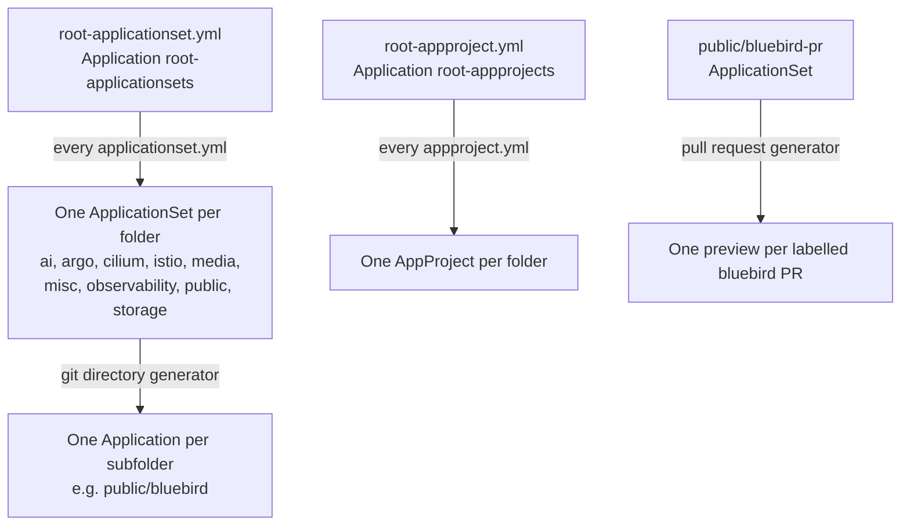

# Architecture

How Argo CD finds and deploys what this repo holds.

## Layout

- **Folders are app groups.** Each top-level folder (`ai`, `argo`, `cilium`, `istio`, `media`, `misc`, `observability`, `public`, `storage`) holds an `applicationset.yml`, an `appproject.yml`, and one subfolder per app.
- **Each app is a kustomization.** Most pull an upstream Helm chart through kustomize's `helmCharts`, which is why Argo CD runs kustomize with `--enable-helm` (`argo/argo-cd/values.yml`). Every kustomization reads only its own folder.
- **The roots are applied once by hand**, as the README says: `root-appproject.yml`, then `root-applicationset.yml`. From then on, Argo CD finds every `applicationset.yml` and `appproject.yml` itself.
- **A folder named `*.disable*` is skipped** by every generator and by the roots. Nothing there is deployed, and some of it no longer renders.
- **`public/bluebird-pr`** is its own ApplicationSet: a GitHub pull request generator makes one preview of bluebird for each PR labelled `create pr container`, from the bluebird-helm chart.

## What is outside the repo

Secrets and the ZFS volumes behind the statically provisioned PersistentVolumes are created by hand, as the README lists. Argo CD can't create them, because they are not tracked here.
