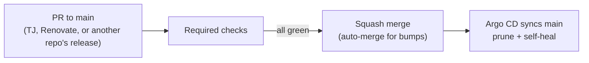

# CI/CD

How a change gets from a PR to the cluster.



## PR checks

| Workflow | Check | What it does |
|---|---|---|
| `pr.yml` | `Validate manifests` | argocd-diff-preview renders the apps the PR touches with Argo CD, in a throwaway kind cluster on the runner, for both `main` and the PR, and posts the rendered diff as a sticky comment. A manifest Argo CD can't render fails it. Record: [0001](architectural-decision-records/0001-argo-cd-renders-every-pr.md) |
| `pr.yml` | `Validate Terraform` | `terraform fmt -check`, `validate` and `test` on `terraform/cloudflare`, in the `hashicorp/terraform` image. It runs on every PR so it can be required. |
| `pr-title.yml` | `PR Title / PR Title` | zimmertr/yggdrasil's `pr-title` module: the title must be `type(scope): summary`. |
| `lint.yml` | `Lint / actionlint`, `Lint / zizmor`, `Lint / semgrep` | zimmertr/yggdrasil's `lint` module: actionlint and zizmor over the workflows. Semgrep's Dockerfile rule finds nothing to scan here. |

Branch protection requires all six, with admins included. Renaming a job means updating the required checks in the same change.

### What `Validate manifests` renders

- Each ApplicationSet and each app it generates carries an `argocd-diff-preview/watch-pattern` annotation ([CONFIGURATION.md](CONFIGURATION.md#watch-patterns)). Only the apps whose folder the PR touches are rendered, plus any ApplicationSet whose own file changed.
- A PR that touches no app selects nothing, and the tool stops before it creates a cluster.
- The throwaway Argo CD is the chart version `argo/argo-cd/kustomization.yml` pins in the PR, with `--enable-helm`, so it renders the way the cluster does.
- The annotations are read from `main`, so a PR that adds one renders every app once.

## Bump PRs from other repos

bluebird, bluebird-helm, hevy-trainer-sync, Personal-Website and Mountaineers-Activity-Scraper release through zimmertr/yggdrasil's `release` module. After a release, it opens a PR here that sets the new image tag or chart version, titled `chore: bump ...`, and arms auto-merge. The PR merges itself once the checks above pass. Renovate leaves those packages alone (`.github/renovate.json`), so no bot PR races the release.

## Renovate

Renovate keeps the charts, images and tools current ([CONFIGURATION.md](CONFIGURATION.md#renovate)). Its PRs are titled `chore(deps): update ...`. Minor and patch updates merge themselves once they are seven days old and the checks pass. yggdrasil's module pin waits three days instead. Majors wait for TJ.

## After the merge

Argo CD polls `main` and syncs every app with prune and self-heal. To skip the wait for one app:

```bash
kubectl -n argo-system annotate application <app> argocd.argoproj.io/refresh=normal --overwrite
```
